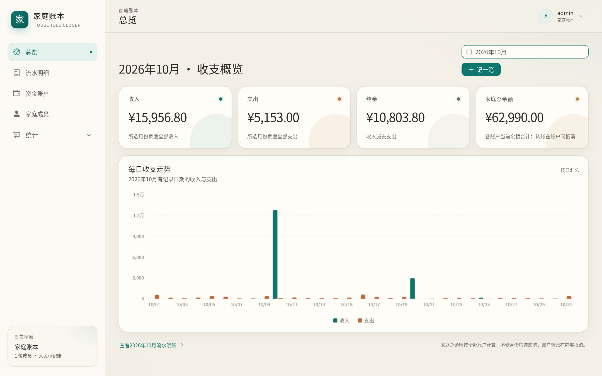
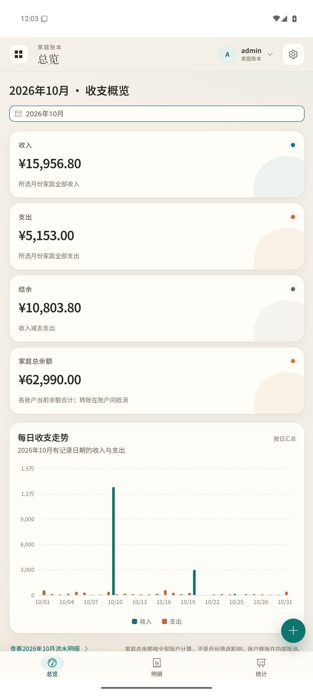

# 家庭账本

中文家庭收支记账应用。一个家庭共用同一份账本：管理员为家庭成员开通账号，成员各自登录，一起记录账户余额、收入、支出和账户之间的转账；电脑和手机浏览器都能使用，也可安装 Android 客户端。

数据保存在自己部署的服务器上，没有第三方云服务，也没有演示数据或默认密码。

## 能做什么

- **一家人共用一本账**：管理员创建成员账号；成员用自己的账号登录，看到同一份家庭账本。
- **账户与余额**：现金、银行卡、微信等资金账户分别记录当前余额，可按成员或“公共账户”分组查看、排序。
- **记一笔**：支出、收入、账户间转账；两级分类、自定义图标和分类排序，手机上有数字键盘和全屏记账窗口。
- **查账与统计**：按月份、账户、类型、关键词筛选流水；查看月度收入、支出、结余和每日收支图表。
- **身份与安全**：管理员负责开户和重置密码，成员只能修改自己的资料；密码加密保存，登录状态可维持在个人设备上 30 天。
- **手机客户端**：可安装 Android 应用，填入自己的服务器地址即可使用，并可在应用内检查更新。

## 界面截图

以下截图来自实际运行的应用，使用临时演示账本，金额和记录均为示例数据。

### Web 端



### Android App



## 用 Docker Compose 部署

需要 Docker 和 Docker Compose。

```sh
cp .env.example .env
openssl rand -hex 32
```

1. 把生成的十六进制字符串填入 `.env` 的 `POSTGRES_PASSWORD`；数据库密码不能为空。
2. 填写 `ADMIN_PASSWORD` 作为管理员密码：至少 10 个字符、最多 72 字节，首次启动时用它创建 `admin` 账号。
3. 本机用 HTTP 试用时，把 `COOKIE_SECURE` 改为 `false`。
4. 启动：

```sh
docker compose up -d --build
```

打开 <http://localhost:8080>，用 `admin` 和设置的 `ADMIN_PASSWORD` 登录，再到「家庭成员」创建家人账号。

应用只绑定本机端口，数据库端口不对外开放；账本保存在 `postgres_data` 数据卷中，停止容器不会丢数据。

## 正式部署

在应用前面配置 HTTPS 反向代理，并把 `COOKIE_SECURE` 保持为 `true`：

- 代理目标为应用的本机端口（默认 `127.0.0.1:8080`）。
- 保留原始 `Host`，或通过 `ALLOWED_ORIGINS=https://你的域名` 指定允许的来源。
- 传递 `X-Forwarded-Proto`，请求体上限至少 `3m`（头像上传需要）。
- 不要把 HTTP 配置直接暴露到公网。

请定期备份，并实际测试恢复：

```sh
docker compose exec -T db pg_dump -U household_bills -d household_bills -Fc > household-bills.dump
```

备份文件应另存到独立设备。停止服务用 `docker compose stop`；`docker compose down -v` 会删除数据库数据，不要当作普通停止命令。

## 配置项

Docker Compose 从根目录 `.env` 读取以下配置：

| 变量 | 说明 |
| --- | --- |
| `POSTGRES_PASSWORD` | 必填，数据库密码；建议用十六进制避免 URL 转义问题 |
| `ADMIN_PASSWORD` | 首次启动必填，创建或更新 `admin` 密码；之后留空则保持原密码 |
| `PORT` | 宿主机访问端口，默认 `8080` |
| `COOKIE_SECURE` | 默认 `true`；只有本机或可信内网 HTTP 时才设为 `false` |
| `ALLOWED_ORIGINS` | 可选，逗号分隔的公开来源地址 |
| `ANDROID_RELEASE_HOST_DIR` | 可选，存放 Android 安装包的宿主目录，默认 `./android/release` |

不使用 Docker、直接运行程序时的其余配置见 [开发与构建](docs/development.md)。

## 本机 systemd 运行（可选）

当前主机还以 `nixos` 用户运行 `household-bills.service`，监听 `127.0.0.1:9890`，只允许本机连接，已启用开机启动。

- 服务文件：`~/.config/systemd/user/household-bills.service`
- 私有环境文件：`~/.config/household-bills/environment`（权限 `0600`，含数据库连接信息，不要公开）
- 程序目录：`/home/nixos/github/Household_Bills`
- 常用命令：`systemctl --user status|restart|stop household-bills`、`journalctl --user -u household-bills -f`

Nginx 由部署者单独配置，反代到 `http://127.0.0.1:9890`，保留 `Host`、传递 `X-Forwarded-Proto`、请求体至少 `3m`。当前允许来源为 `https://bill.bykkyy.top` 和 `https://bill.bykkyy.top:888`；域名或端口变化时，修改环境文件里的 `ALLOWED_ORIGINS` 并重启服务。

更新时先备份数据库，重新构建前后端后再重启；只拉取代码不会自动生效。

## Android 客户端

Android 8.0 及以上可用。客户端本身不存账本，需要填写服务器地址：

1. 首次打开填写手机能访问的服务器根地址，例如 `https://ledger.example.com`；不能填 `/api`、页面路径或电脑上的 `localhost`。
2. 进入账本后，网页顶栏头像右侧的齿轮打开「应用设置」；地址会自动保存，更换服务器需确认并会清除旧站点的登录状态。
3. 网页更新后，可在「设置 → 页面缓存 → 刷新页面缓存」重新加载页面；账本数据和登录状态不受影响。
4. 有新版本时，可在「设置 → 应用更新 → 检查更新」下载并安装，首次可能需要允许本应用「安装未知应用」。

推荐 HTTPS；只有可信内网测试才用 HTTP，并让服务端 `COOKIE_SECURE=false`。升级到 1.0.3 及以上的客户端前，先部署包含应用设置入口的新版网页，并在旧版应用里刷新一次页面缓存，避免新外壳加载没有齿轮的旧页面。源码构建、签名和发布流程见 [开发与构建](docs/development.md)。

## 使用要点

- `admin` 是固定的管理员账号，不计入家庭成员名单，也不能被删除；成员账号只能由管理员创建。
- 账户余额随每笔收入、支出和转账自动更新；月度结余为当月收入减当月支出，转账只在账户之间划转，不计入收支统计。
- 流水和账户的“归属成员”只用于标记和展示，不改变共享权限；成员被删除后历史记录仍保留。
- 记账时间按本地时间精确到秒；升级旧数据时不推测历史时刻。
- 各类分类（支出、收入）由全家人共享，修改后在下次打开记账时生效；多人同时编辑会提示冲突，不会静默覆盖。
- 登录时可勾选「记住登录（30 天）」，仅建议在个人设备使用；退出登录或修改密码会使相关登录失效。

## 更多文档

- [开发、测试与 Android 打包](docs/development.md)
- [任务与需求变更记录](docs/changes/README.md)
